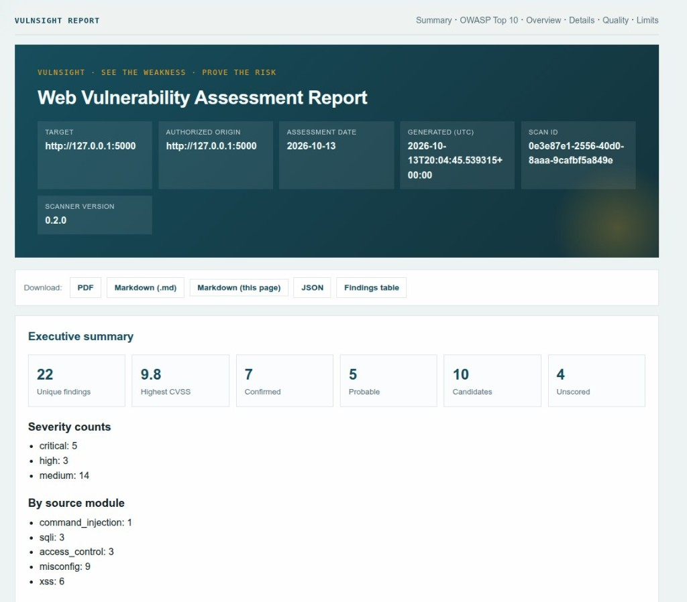
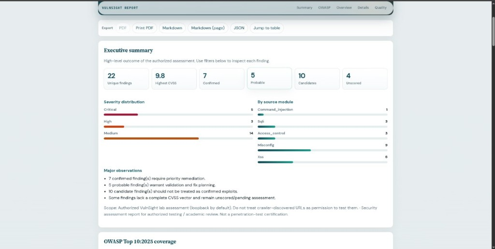
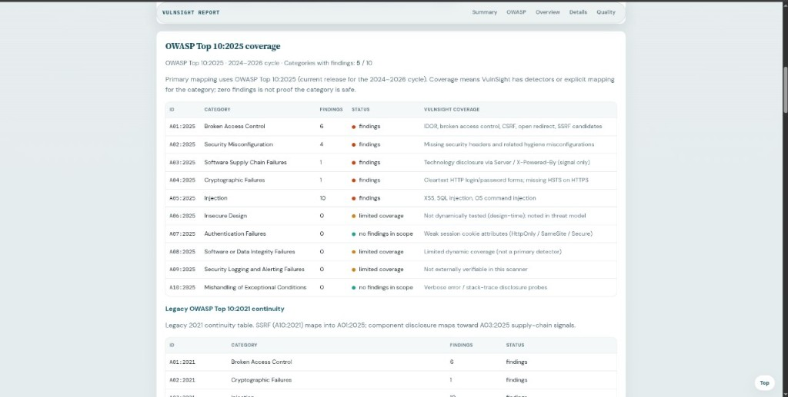

# VulnSight

**Modular command-line web vulnerability scanner for authorized local assessments.**

[](https://www.python.org/)
[](LICENSE)
[](tests/)
[](CHANGELOG.md)
[](https://epedev.github.io/VulnSightz/)
[](https://github.com/epedev/VulnSightz)

VulnSight is a Group 3 graduation project: an ethically constrained scanning pipeline that combines explicit authorization, reconnaissance, multi-class vulnerability detection, and professional reporting in a single CLI.

> **Authorized use only.** Scan only systems you own or have written permission to test. The optional training lab in [`vulnerable-target-app/`](vulnerable-target-app/) is intentionally vulnerable and must run on `127.0.0.1` only.

## Contents

- [Features](#features)
- [Pipeline](#pipeline)
- [Installation](#installation)
- [Quick start](#quick-start)
- [Test lab: vulnerable target app](#test-lab-vulnerable-target-app)
- [Demonstration](#demonstration)
- [Secure vs vulnerable comparison](#secure-vs-vulnerable-comparison)
- [Documentation](#documentation)
- [Testing](#testing)
- [Security](#security)
- [Team](#team)
- [License](#license)

---

## Features

- **Authorization first:** scans require a project file (`init-project` / `scan --project`) that records who authorized the test.
- **Reconnaissance:** same-origin crawler that produces `crawl_map.json`.
- **Detection modules:** XSS, SQL injection, command injection, and access control (IDOR).
- **Security hygiene checks:** headers, cookies, CSRF candidates, open redirect, SSRF signals, and information disclosure.
- **Standards mapping:** OWASP Top 10:2025 classification with 2021 continuity tables, plus CVSS scoring where a defensible vector exists.
- **Reporting:** HTML, Markdown, PDF, and JSON output.
- **Comparison mode:** `vulnsight compare` contrasts a vulnerable build against a secure baseline.
- **Lab-first defaults:** loopback targets only, with explicit opt-in for anything else.
- **Interactive documentation:** `vulnsight docs`.

## Pipeline

```
Authorize → Recon → Detect (XSS / SQLi / Cmd / Access / Hygiene) → Report
```

| Module | Path | Responsibility |
|--------|------|----------------|
| Orchestrator / CLI | `vulnsight/` | Project authorization, scope, scan orchestration |
| Reconnaissance | `Crawler/` | Same-origin crawl map |
| XSS | `xss_module/` | Reflected and stored XSS |
| Injection | `sqli_&_command_module/` | SQL injection and command injection |
| Access control | `access_control_module/` | IDOR and broken access control |
| Security hygiene | `misconfig_module/` | Headers, cookies, CSRF, open redirect, disclosure |
| Reporting | `reporting_module/` | Normalization, CVSS, OWASP mapping, HTML / MD / PDF / JSON |
| Test lab (optional) | `vulnerable-target-app/` | Deliberately vulnerable Flask app to scan |

---

## Installation

**Requirements:** Python 3.10+ and an authorized local website to test (you can use the bundled lab below). PDF export uses ReportLab, which is installed by default; WeasyPrint is an optional extra for HTML-faithful PDFs.

```bash
git clone https://github.com/epedev/VulnSightz.git
cd VulnSightz

python3 -m venv .venv
source .venv/bin/activate          # Windows: .\.venv\Scripts\Activate.ps1

pip install -e ".[dev]"
vulnsight doctor
```

## Quick start

```bash
# 1. Start a local website under test on http://127.0.0.1:5000
#    (the bundled lab works: see the next section)

# 2. Create an authorization project file
vulnsight init-project -o myproject.json --target http://127.0.0.1:5000
#    then set authorization.authorized_by in myproject.json

# 3. Run the full pipeline
vulnsight scan --project myproject.json
```

Reports are written to `reports/`:

| Artifact | Description |
|----------|-------------|
| `vulnsight_report.html` | Interactive report with download controls |
| `vulnsight_report.md` | Markdown report |
| `vulnsight_report.pdf` | PDF report |
| `findings.json` | Machine-readable findings |

---

## Test lab: vulnerable target app

Want to try VulnSight without building your own target? The repository includes [`vulnerable-target-app/`](vulnerable-target-app/), a small Flask application with deliberately planted vulnerabilities, so you can run a full scan and see real findings.

> **Warning:** this app contains real vulnerabilities, including OS command injection. Run it only on your own machine, bound to `127.0.0.1`. Never expose it to a shared network or the internet, and never deploy it.

**What it contains**

| Route | Planted flaw |
|-------|--------------|
| `/login` | SQL injection (CWE-89) |
| `/search` | Reflected XSS (CWE-79) |
| `/comments` | Stored XSS (CWE-79) |
| `/profile/<id>` | IDOR (CWE-639) |
| `/admin` | Broken access control (CWE-284/285) |
| `/ping` | OS command injection (CWE-78) |
| `/robots.txt`, `/sitemap.xml` | Recon surface for the crawler |

Root cause, exploitation, impact, detection, and fix for each flaw are documented in [`vulnerable-target-app/VULNERABILITIES.md`](vulnerable-target-app/VULNERABILITIES.md).

**Run it** (in a separate terminal from the scanner):

```bash
cd vulnerable-target-app
python3 -m venv venv
source venv/bin/activate
python -m pip install -r requirements.txt
python init_db.py        # creates and seeds target.db
python app.py            # serves http://127.0.0.1:5000
```

Then scan it from the repository root:

```bash
vulnsight init-project -o myproject.json --target http://127.0.0.1:5000
# set authorization.authorized_by in myproject.json
vulnsight scan --project myproject.json
```

**Notes**

- Seeded training accounts: `alice` / `alice123`, `bob` / `bobpass`, `admin` / `SuperSecret99!`. These are intentionally weak demo credentials.
- Re-running `python init_db.py` resets all data, including submitted comments.
- A default scan typically reports around 20 findings. Some stored-XSS candidates on routes that do not persist input are false positives; see [`fixtures/expected_findings/README.md`](fixtures/expected_findings/README.md).
- The `/ping` route uses `ping -c 1`, which works on Linux and macOS. On Windows, command-injection behavior will differ.
- More detail: [`vulnerable-target-app/README.md`](vulnerable-target-app/README.md) and [`vulnerable-target-app/docs/TESTING.md`](vulnerable-target-app/docs/TESTING.md).

---

## Demonstration

An authorized local scan against a prepared vulnerable target, with VulnSight producing an assessment report.








## Secure vs vulnerable comparison

```bash
vulnsight compare \
  --current reports/findings.json \
  --baseline fixtures/secure_baseline_findings.json \
  --output reports
```

---

## Documentation

| Document | Description |
|----------|-------------|
| [Interactive docs](https://epedev.github.io/VulnSightz) | Pipeline explorer, scan theater, findings playground (`vulnsight docs`) |
| Demo video | [Watch the recorded demonstration](Assets/video/vulnsight_test.mp4) |
| Final documentation | [Read the final documentation](Assets/final%20documentation) |
| [docs/index.html](docs/index.html) | Same showcase, offline |
| [docs/USAGE.md](docs/USAGE.md) | CLI usage |
| [docs/INSTALLATION.md](docs/INSTALLATION.md) | Setup notes |
| [docs/ARCHITECTURE.md](docs/ARCHITECTURE.md) | Module contracts |
| [docs/DEMO_RUNBOOK.md](docs/DEMO_RUNBOOK.md) | Demonstration checklist |
| [docs/SECURITY.md](docs/SECURITY.md) | Authorized-use policy |
| [docs/THREAT_MODEL.md](docs/THREAT_MODEL.md) | Threat model and false positive/negative guidance |
| [docs/OWASP_TOP10.md](docs/OWASP_TOP10.md) | OWASP Top 10:2025 mapping |
| [vulnerable-target-app/](vulnerable-target-app/) | Bundled training target and vulnerability write-ups |
| [AUTHORS.md](AUTHORS.md) | Project contributors |

## Testing

```bash
python -m pytest
```

Optional live-lab tests against a running target:

```bash
export VULNSIGHT_LAB_URL=http://127.0.0.1:5001
python -m pytest tests/integration -q
```

## Security

See [SECURITY.md](SECURITY.md) and [docs/SECURITY.md](docs/SECURITY.md).

- Crawler discovery is not authorization.
- Prefer loopback targets for academic demos.
- Do not scan systems without written permission.
- Absence of findings is not a certification of security.

## Team

Group 3:

| Student name | Student ID |
|--------------|------------|
| Kenean Amare Eshetu | CTC-4837-26 |
| Kenneti Hailu Dange | CTC-535-26 |
| Kidsit Ephrem | CTC-6744-26 |
| Alazar Elias Digafe | CTC-631-26 |
| Firaol Mustefa Gossa | CTC-4301-26 |

See also [AUTHORS.md](AUTHORS.md).

## License

Released under the [MIT License](LICENSE).
